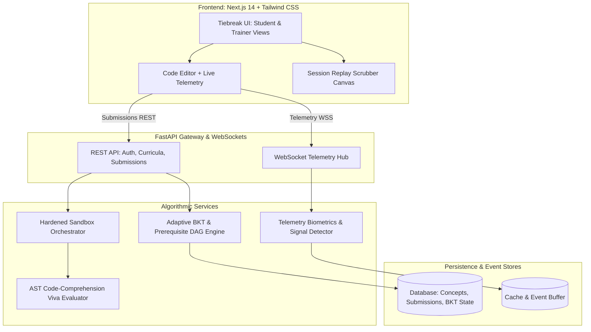

# BrackYou — Adaptive Learning & Evidentiary Assessment Portal
> **Hackathon PS2:** An adaptive, prerequisite-aware learning and assessment portal that evaluates **how** students arrive at an answer, not just the code itself.

---

## ⚡ Core Pillars & Innovations

1. **Adaptive Bayesian Knowledge Tracing (BKT) over a Prerequisite DAG:**
   - Continuously traces latent knowledge $P(L_t)$ per concept across attempt sequences.
   - Gating rules prevent compounding debt: advanced frameworks (e.g. Spring Boot) remain locked until prerequisites (OOP, Inheritance, Interfaces) clear the 70% mastery threshold.
   - Weakest-prerequisite ancestor walk diverts struggling students to remedial concept drills (proven by Student A vs Student B path divergence).

2. **Process-Based Keystroke Forensics (Signals, Not Accusations):**
   - High-frequency event stream: inter-keystroke delay (IKD), paste volume, cadence variation, write-run-fix loop iterations, and tab switches.
   - Flags anomalies (e.g., bulk paste of 340 characters in 1 tick) with exact millisecond timestamps.
   - **Human-in-the-Loop:** Evaluators inspect falsifiable evidence in a deterministic scrubbable replay player with a human disposition workflow and student rebuttal channel.

3. **Adversarially Hardened Multi-Language Sandbox:**
   - Evaluates submissions against visible and hidden test cases.
   - Micro-isolation with 3000ms wall-clock watchdog kill, memory ceiling (128MB), PIDs limit (64 to neutralize fork bombs), read-only rootfs, and zero network egress (`--net=none`).

4. **AST-Ground Code Comprehension (AI Viva):**
   - Parses AST diffs of the student's solution to generate 2–3 questions regarding design decisions (e.g., "Why did you declare `UserRepository` as constructor-injected and immutable?").
   - Rubric-based semantic evaluator grades the explanation against the implementation.

5. **"Tiebreak" Retro-Modern Design System:**
   - Warm cream canvas (`#FDF6E8`), dark brown typography (`#2D1B0E`), bold rounded cards (16px), chunky pill buttons, 10-block segmented progress bars, and status corner ribbons.
   - Multi-format Results Dashboard: Mastery %, Pedagogical LLM Summary, Test Checklist, Code/Terminal View, Cohort Comparison, and Forensic Timeline Scrubber.

---

## 🏗️ System Architecture



---

## 🚀 Quickstart Guide

### Option 1: Docker Compose (All Services)
```bash
docker-compose up --build
```
- **Web Portal:** `http://localhost:3000`
- **FastAPI Docs:** `http://localhost:8000/docs`

---

### Option 2: Local Development

#### 1. Backend Setup
```bash
cd backend
python -m venv venv
# On Windows:
.\venv\Scripts\activate
# On Linux/macOS:
source venv/bin/activate

pip install -r requirements.txt
python -m backend.app.seed.seed_data
python -m uvicorn backend.app.main:app --reload --port 8000
```

#### 2. Frontend Setup
```bash
cd frontend
npm install
npm run dev
```
Open [http://localhost:3000](http://localhost:3000) in your browser.

---

## 🧪 Adversarial Test Suite

Verify that the hardened sandbox terminates hostile submissions without crashing the server:
```bash
python -m backend.tests.test_core_engine
```
Tests:
- ✅ **BKT Update Verification:** Posterior increases on correct answers, decreases on slips.
- ✅ **Weakest Prerequisite Walk:** Diverts students when prerequisite scores are broken.
- ✅ **Infinite Loop Containment:** `while True: pass` terminated within 1500ms (TLE).
- ✅ **Network Call Intercept:** `socket.socket()` prohibited and blocked cleanly.

---

## 🎭 The 4-Minute Hackathon Demo Script

1. **(0:00 - 0:45) The Problem & The Prerequisite DAG:**
   - Open `/student/dashboard`. Explain how traditional static sequences fail because prerequisite gaps compound silently.
   - Switch persona between **Alex Chen (Advanced)** and **Jonah Miller (Struggling)**.
2. **(0:45 - 1:30) Visible Path Divergence:**
   - Show how Alex is routed directly to **Dependency Injection** (OOP solid).
   - Show how Jonah is diverted to a **Constructor & Object Reference Remediation Drill** because his inheritance score is 25% (Spring Boot is gated).
3. **(1:30 - 2:15) Hardened Sandbox Execution:**
   - Open `/student/assess/q_di_1`.
   - Run tests. Show test cases passing in the sandboxed console.
   - Show Socratic hint reveal with conversational pedagogical guidance.
4. **(2:15 - 3:00) Telemetry Replay & Forensic Integrity:**
   - Open `/student/results/session_demo_alex`.
   - Show all 6 formats: BKT Percentage, LLM Summary, Test Checklist, Code diff, Cohort comparison, and the Timeline Scrubber.
   - Click the ⚠ **06:14 flag** to demonstrate how the platform deep-links to the exact moment 340 characters arrived in 1 tick.
   - Read the student's rebuttal and show that the platform frames this as *evidence for human review*, never an automatic verdict.
5. **(3:00 - 3:30) AI Code Viva:**
   - Show the AI quoting the student's exact class and method names.
   - Answer the question, verify the semantic match score (95%), and observe the live BKT update.
6. **(3:30 - 4:00) Trainer Cohort Heatmap:**
   - Open `/trainer`. Show the class-wide mastery heatmap (identifying batch-wide bottlenecks like 60% failing Inheritance) and review queue.

---

## 📂 Repository Layout

```text
BrackYou/
├── backend/
│   ├── app/
│   │   ├── api/             # REST endpoints (auth, curriculum, adaptive, assessment, telemetry, viva, trainer)
│   │   ├── models/          # SQLAlchemy entities and database schema
│   │   ├── services/        # BKT engine, DAG resolver, sandbox runner, telemetry analyzer, viva evaluator
│   │   └── seed/            # Java OOP curriculum DAG, questions, demo profiles
│   ├── tests/               # Adversarial and unit tests
│   ├── Dockerfile
│   └── requirements.txt
├── frontend/
│   ├── src/
│   │   ├── app/             # Next.js App Router pages (Dashboard, Skill Tree, Assessment, Results, Trainer)
│   │   ├── components/      # Tiebreak UI primitives (PillButton, SegmentedBar, RibbonCard, Navbar)
│   │   └── lib/             # API client & design constants
│   ├── Dockerfile
│   └── package.json
├── docker-compose.yml
└── README.md
```
